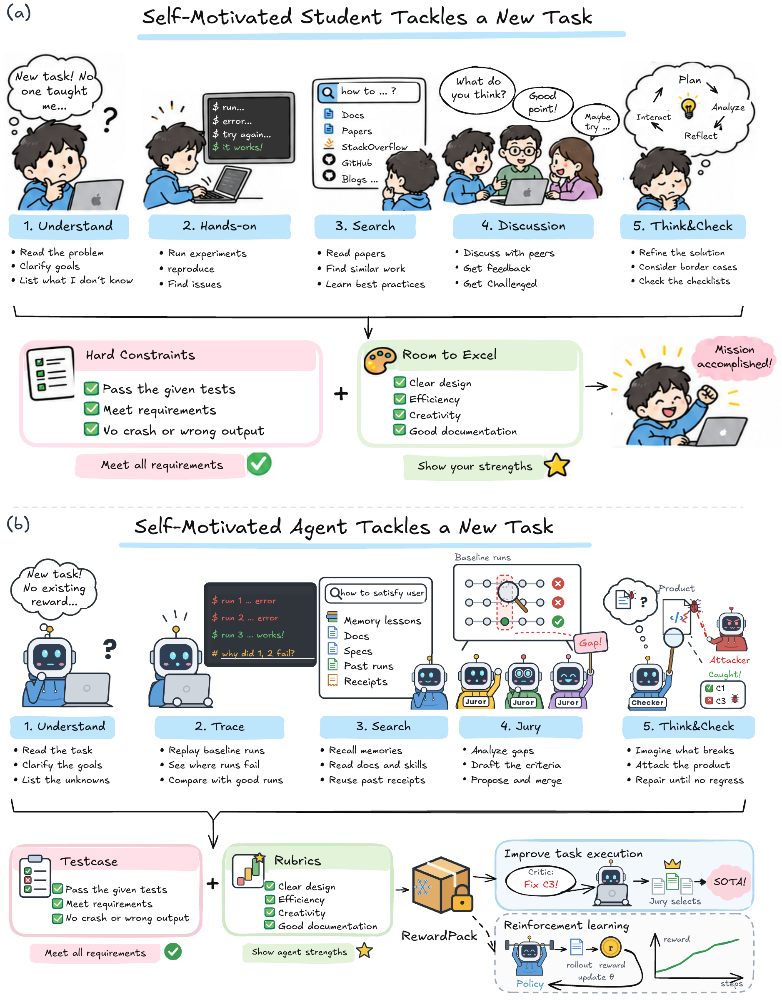
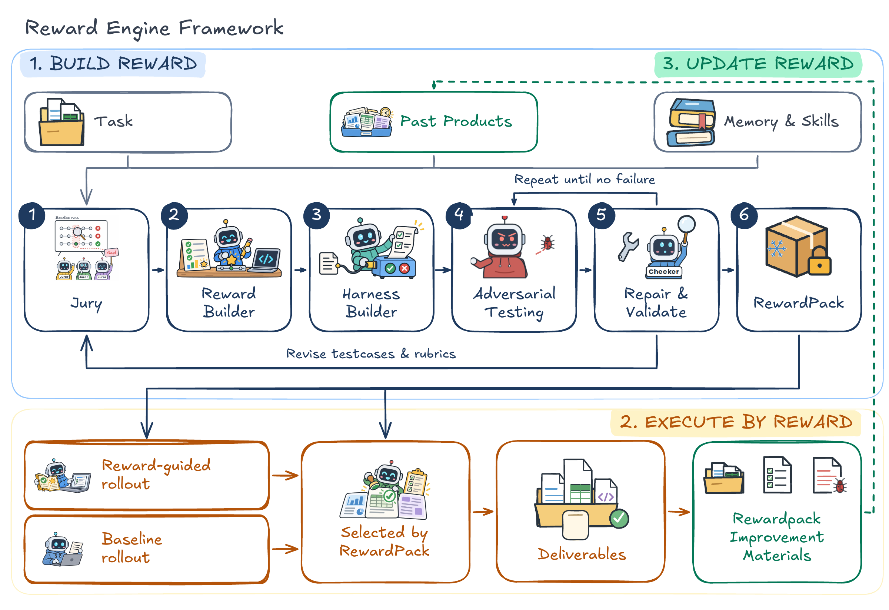

# Reward Engine

Reward Engine constructs executable task criteria, measures candidate work, and uses evidence to guide revisions and selection. A RewardPack remains frozen within each round. The controller updates evidence and memory between rounds; it does not train model weights. Native benchmark grading remains isolated from learning and selection.



*Figure 1 from the paper. Testcases and rubrics, bound to executable checks, form a frozen RewardPack. The reinforcement-learning branch is a possible extension and is not evaluated.*



*Figure 2 from the paper. Build reward, execute by reward, and update reward. Benchmark scores remain reserved for evaluation.*

## Install and run offline

Python 3.11 or later is required for the core. No API or benchmark assets are needed for the deterministic example.

```sh
python -m venv .venv
. .venv/bin/activate
pip install .
python -m reward_engine.examples.minimal --output _local/runs/minimal
```

The example executes construction, measurement, revision, selection, and memory with synthetic roles. Its receipts demonstrate controller behavior, not model performance.

## Connect a model

```sh
pip install '.[demo]'
export OPENAI_API_KEY='YOUR_API_KEY'
python -m reward_engine.examples.minimal --live \
  --model YOUR_MODEL_ID --base-url https://api.example.com/v1 \
  --output _local/runs/live
```

Use an OpenAI-compatible Chat Completions API supporting JSON-object responses. See [configuration](docs/configuration.md) for benchmark role profiles and credential precedence.

## Runtime and benchmark support

Both OpenCode and JiuwenSwarm support the Claw-Eval and Office adapters, including the fixed-baseline three-B protocol. New runs default to JiuwenSwarm; select OpenCode with `--runtime opencode`. Historical frozen configurations retain their existing interpretation.

| Runtime | Required external installation | Selection |
| --- | --- | --- |
| JiuwenSwarm | Python 3.12 runtime bundle with workswarm 0.2.7 and Process CLI 0.1 | `--runtime jiuwenswarm --jiuwenswarm-bundle /path/to/bundle` |
| OpenCode | Compatible OpenCode binary; set `OPENCODE_BINARY` | `--runtime opencode` |

Native runs also require Docker, separately obtained benchmark assets and model access. Install controller dependencies with `pip install '.[runtime,workbuddy]'`. See [benchmark setup](experiments/README.md), [Claw-Eval](experiments/claw_eval/README.md), [Office](experiments/workbuddy/README.md), and [JiuwenSwarm bundle instructions](reward_engine/adapters/jiuwenswarm/README.md).

See [architecture](docs/architecture.md) and [module documentation](reward_engine/README.md). Source: [LeibnizFlow/reward-engine](https://github.com/LeibnizFlow/reward-engine). Licensed under [Apache 2.0](LICENSE); see [third-party notices](docs/LICENSES.md).
