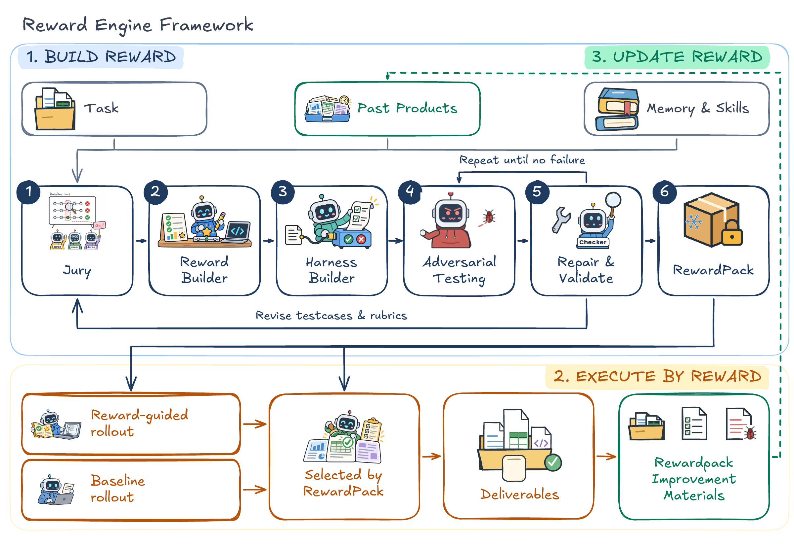
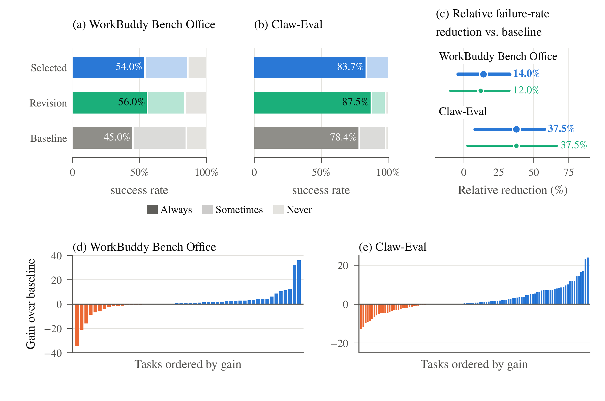

# Reward Engine

**Build an executable reward for an open-ended task, then use it to improve an agent's work.**

Reward Engine turns task requirements and candidate trajectories into a **RewardPack**: testcases for required correctness, rubrics for graded quality, and executable checks that return judgments with evidence. The pack stays frozen while it guides feedback, revision, and candidate selection. Products and receipts inform the next construction round; the loop does not update model weights.



The framework has three stages:

1. **Build reward.** Jury members propose task expectations and review candidates; a Builder binds the resulting criteria to executable checks.
2. **Execute by reward.** Measure candidate work, give feedback to the same actor, and compare completed candidates. Selection requires a strict preference over the fresh task-only baseline with no known checked regression.
3. **Update reward.** Persist evidence and memory for subsequent rounds, without changing the reward during the current execution.

The figure also shows optional counterexample review and repair. These require explicit configuration; adversarial review is disabled by default. Benchmark graders remain separate and are used only for evaluation.

## Quick start

Python **3.11+** is sufficient for the offline example. From a checkout, run the commands below. No API key, Docker, GPU, or historical experiment data is needed.

```sh
python3 -m venv .venv
.venv/bin/python -m pip install .
.venv/bin/python -m reward_engine.examples.minimal --output _local/runs/minimal
```

This runs the actual core controller for three rounds with explicitly synthetic, deterministic roles and a small text task. It exercises construction, checks, feedback, revision, selection, and memory. Use a new output directory for each run.

Inspect `summary.json` for completed rounds, selections, revision counts, and memory; `round_1/` through `round_3/` contain the detailed receipts. This example demonstrates the controller, not live model quality or benchmark results.

## Use a model API

Install the lightweight API dependencies and supply an OpenAI-compatible Chat Completions endpoint:

```sh
.venv/bin/python -m pip install '.[demo]'
export OPENAI_API_KEY='YOUR_API_KEY'
.venv/bin/python -m reward_engine.examples.minimal --live \
  --model YOUR_MODEL --base-url https://your-provider.example/v1 \
  --key-env OPENAI_API_KEY --output _local/runs/minimal-live
```

The endpoint must support non-streaming JSON-object responses. This example uses one model for all roles. Model calls use your provider account; invalid responses fail explicitly. See the [usage guide](docs/quickstart.md) for credentials, parameters, and output details.

## Native benchmark adapters

| Adapter | Environment | Entry point |
|---|---|---|
| [WorkBuddy Bench Office](experiments/workbuddy/README.md) | Native office tasks, workspace snapshots, and verifier | `python -m experiments.workbuddy.experiment` |
| [Claw-Eval](experiments/claw_eval/README.md) | Native tool environment, interaction trace, and grader | `python -m experiments.claw_eval.opencode.campaign` |

Native runs additionally require Python 3.12, benchmark assets, Docker, OpenCode, and model access. Follow [native setup](experiments/README.md) before starting them. These dependencies and datasets are not bundled with the core package.

## Research context



The manuscript reports three-run success consistency (Pass³) increasing from **45.0% to 54.0%** on WorkBuddy Bench Office and from **78.4% to 83.7%** on Claw-Eval. These are historical manuscript results, not measurements produced by the quick start or a guarantee for a new provider or configuration. The reinforcement-learning and cross-task meta-learning extensions are not evaluated in those experiments. See [figure provenance](docs/figures/README.md).

## Explore the implementation

- [Architecture](docs/architecture.md) and [Outcome core](reward_engine/core/outcome/README.md)
- [Arm protocols](reward_engine/core/outcome/ARMS.md), [runtime critic](reward_engine/core/outcome/POLICY_CRITIC.md), and [measurement tools](reward_engine/core/outcome/MEASUREMENT_TOOLS.md)
- [Multi-turn task scopes](reward_engine/core/outcome/MULTITURN.md) and [optional public-task reward](reward_engine/core/outcome/PUBLIC_REWARD.md)

The project code is licensed under [Apache-2.0](LICENSE). Benchmark data and third-party components retain their own terms; see [licenses and provenance](docs/LICENSES.md).
