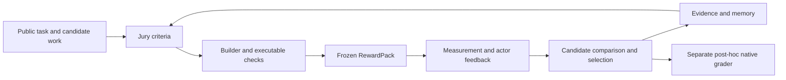

# Architecture

Native experiment entry points call benchmark adapters, which call `reward_engine.core.outcome`. WorkBuddy and Claw-Eval share construction, review, memory, and selection while retaining their own task inputs, artifact collection, and native grading.

The core separates a criterion's definition from its executable measurement and from model-assisted interpretation. Check results retain evidence and distinguish `pass`, `fail`, and `unknown`; unavailable execution is not a product failure. A frozen pack remains fixed while it guides the current execution. Memory and defects inform later construction rounds.

Native scores are evaluation outputs and never inputs to generation, reward construction, or runtime selection. Public task updates establish new requirement scopes; internal critic feedback does not create user requirements.

The [Outcome interface guide](../reward_engine/core/outcome/README.md) describes the controllers. [Adapters](../reward_engine/adapters/README.md) handle actual environments and artifact snapshots. Runtime checkpoints and portable evidence exports have distinct roles: checkpoints support execution, while exports preserve paths, evidence identity, and score bindings. File indexes retain original and public hashes; exported bytes are verified before original receipt bindings are checked.
