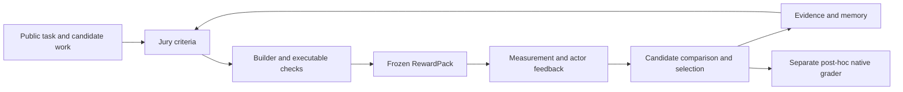

# Architecture

Native experiment entry points call benchmark adapters, which call `reward_engine.core.outcome`. WorkBuddy and Claw-Eval share construction, review, memory, and selection while retaining their own task inputs, artifact collection, and native grading.

The public `jury` module coordinates proposals and retains its existing imports.
Standard validation, reduction and ranking live in `jury_validation`,
`jury_reduction` and `jury_ranking`. The public `harness` module owns the checker
registry; claim validation, checker construction and measurement execution live
in `harness_claims`, `harness_checkers` and `harness_measurement`.
These boundaries separate evidence contracts from model orchestration while
preserving the existing request and result formats.

The pipeline audit entry point composes receipt, native execution, measurement
and review checks from focused modules. Its public imports and CLI exit codes
remain stable. Actor retry policies share authorization archiving, but each
policy retains its own eligibility checks and execution limits. Refactoring the
maintained source never rewrites a frozen experiment's code or evidence.

The core separates a criterion's definition from its executable measurement and from model-assisted interpretation. Check results retain evidence and distinguish `pass`, `fail`, and `unknown`; unavailable execution is not a product failure. A frozen pack remains fixed while it guides the current execution. Memory and defects inform later construction rounds.

Native scores are evaluation outputs and never inputs to generation, reward construction, or runtime selection. Public task updates establish new requirement scopes; internal critic feedback does not create user requirements.

The [Outcome interface guide](../reward_engine/core/outcome/README.md) describes the controllers. [Adapters](../reward_engine/adapters/README.md) handle actual environments and artifact snapshots. Runtime checkpoints and portable evidence exports have distinct roles: checkpoints support execution, while exports preserve paths, evidence identity, and score bindings. File indexes retain original and public hashes; exported bytes are verified before original receipt bindings are checked.

Claw exposes the runtime-neutral `experiments.claw_eval.campaign` entry.
Its historical OpenCode entry remains a compatibility interface, while
`experiments.claw_eval.report` owns report generation. Both benchmark CLIs
normalize `--runtime` into the existing frozen `actor_backend` field, so
renaming a command does not change saved runtime identities.
